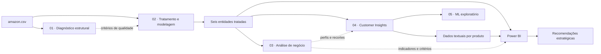

# Amazon Product Performance & Customer Insights

**Tech Challenge · Pós-graduação em Data Analytics — FIAP**  
**Projeto individual | Python · Jupyter · Power BI**

Análise do catálogo de produtos da Amazon a partir de preços, descontos, avaliações e textos associados aos produtos. O projeto parte do diagnóstico da base original, estrutura os dados em entidades relacionadas, desenvolve análises comerciais e textuais e consolida os resultados em um dashboard interativo de seis páginas.

**[Dashboard Power BI (.pbix)](dashboard.pbix)** · **[Relatório técnico (PDF)](Relatorio%20Tecnico%20-%20Analise%20Amazon.pdf)** · **[Vídeo de apresentação](https://www.youtube.com/watch?v=qEtIrhZ8USw)**

## Visão geral

| Indicador | Resultado |
| --- | ---: |
| Produtos distintos | **1.351** |
| Avaliação média dos produtos com nota válida | **4,09** |
| Desconto anunciado médio | **46,68%** |
| Participação das três principais categorias | **97,19%** |
| Produtos identificados no Perfil A / Perfil B | **212 / 299** |

Os perfis comparam nota e quantidade informada de avaliações com as medianas de cada categoria principal. São classificações relativas, não diagnósticos absolutos de qualidade.

## Do dado original ao dashboard

O Notebook 05 explora técnicas de processamento textual. Seus resultados não representam classificações de sentimento validadas e **não alimentam as medidas do dashboard final**.

## Códigos e estrutura do projeto

| Arquivo ou pasta | Finalidade |
| --- | --- |
| [`eda_estrutural/01_eda_estrutural.ipynb`](eda_estrutural/01_eda_estrutural.ipynb) | Diagnóstico da fonte: estrutura, tipos, duplicidades e granularidade dos registros. |
| [`tratamento_dados/02_tratamento_dados.ipynb`](tratamento_dados/02_tratamento_dados.ipynb) | Conversão de campos, seleção de referências, modelagem relacional e validações de integridade. |
| [`eda_negocio/03_eda_negocio.ipynb`](eda_negocio/03_eda_negocio.ipynb) | Distribuições, comparações entre categorias, preços, descontos e classificação de perfis. |
| [`customer_insights/04_customer_insights.ipynb`](customer_insights/04_customer_insights.ipynb) | Preparação do corpus e identificação de menções a custo-benefício, facilidade, bateria e áudio. |
| [`customer_insights/05_machine_learning_textual.ipynb`](customer_insights/05_machine_learning_textual.ipynb) | Experimentos de TF-IDF, NMF e análise contextual; resultados exploratórios. |
| [`customer_insights/resultados_ml/`](customer_insights/resultados_ml/) | Saídas e diagnósticos dos experimentos de Machine Learning. |
| `leitura_dados.py` e `customer_insights/metodos_customer_insights_ml.py` | Funções compartilhadas para leitura e processamento das tabelas e textos. |
| `dados_tratados/` | Seis entidades canônicas e projeção textual utilizada pelo BI. |
| [`dashboard.pbix`](dashboard.pbix) | Modelo, medidas DAX, filtros e visualizações finais. |
| [`RELATORIO_TECNICO.pdf`](Relatorio%20Tecnico%20-%20Analise%20Amazon.pdf) | Regras de transformação, cálculo, rastreabilidade e validações em detalhes. |

**Modelagem:** `produtos` mantém uma linha por `product_id` (1.351 produtos); `ocorrencias_base` preserva as 1.465 linhas de origem. As demais entidades são `categorias`, `usuarios`, `reviews` e `vinculos_reviews`. A projeção `produtos_textuais` agrega menções no nível de produto para uso no painel.

## Dashboard: seis páginas

| Página | Análise |
| --- | --- |
| **01 · Visão Executiva** | Principais indicadores e distribuição do catálogo. |
| **02 · Portfólio e Categorias** | Composição e diferenças entre categorias e subcategorias. |
| **03 · Preços e Descontos** | Faixas de desconto, preços anunciados e associação descritiva com avaliações. |
| **04 · Avaliações e Perfis** | Nota × quantidade de avaliações, perfis por categoria e produtos prioritários. |
| **05 · Customer Insights** | Presença de assuntos nos textos, por categoria e perfil. |
| **06 · Recomendações Estratégicas** | Síntese de prioridades e plano de ação fundamentado nos achados. |

O arquivo `.pbix` é aberto no **Power BI Desktop**. Para atualizar os dados em outra máquina, pode ser necessário alterar os caminhos das consultas CSV em **Transformar dados → Fonte**.
